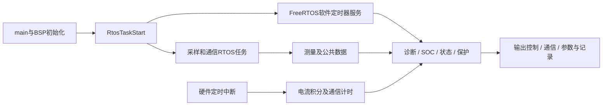

# 工程架构与调度

## 工程身份与配置

该工程是面向S32K146的C固件，使用Processor Expert生成代码、NXP SDK与FreeRTOS。`Sources/main.c:27-36,59-72`给出初始化与RTOS入口，`Debug/makefile:17-48`列出生成代码、S32K146启动代码、驱动和ARM_CM4F移植层。`.project`、`.cproject`和`ProcessorExpert.pe`保留工程配置；Debug/Release是构建产物，不能作为源码已成功重建的证据。

`.cproject:21-31`的Debug工具链配置为S32DS ARM Bare-Metal，目标Cortex-M4、hard-float ABI、FPv4-SP-D16。EKF使用float与expf，因此需要保持浮点ABI、数学库和所有链接对象一致；本轮未实际重建验证。

当前 `Sources/Funtion/SystemInfo/PublicInfo.h:25-70` 的配置为：

| 配置 | 值 | 当前含义 |
|---|---|---|
| CELL_CHEM_TYPE | 2 | 磷酸铁锂 |
| BMU_BSU_COM_TYPE | 0 | 菊花链主从采样 |
| PRJ_PACK_CELL_INFO | 2 | 16S，通道布局8+空1+8 |
| PRJ_PARA_NUM_INFO | 4 | 注释对应标准280Ah、16S×15PACK项目 |
| MAX_BSU_NUM / MAX_BSU_CELL | 15 / 16 | 代码数组最大240个单体，不能据此断言现场实装数 |
| PILE_MANAG_EN | 0 | 当前禁用电池堆并机管理 |
| BMU_SELF_CAN_EN | 1 | 自研内部CAN协议使能 |
| BMU_CATL_CAN_EN | 0 | CATL兼容CAN未使能 |

目录存在某种功能，不等于当前构建启用了它。运行时参数、EEPROM值和现场硬件仍可能与默认项目注释不同。

## 分层地图

| 层 | 目录 | 阅读用途 |
|---|---|---|
| 芯片与系统基础 | SDK、Generated_Code、Project_Settings | 外设、FreeRTOS、时钟、中断、链接布局 |
| 板级硬件抽象 | Sources/BSPSys | BSP配置、ISR钩子、ADC/CAN/SCI/GPIO及芯片驱动 |
| 基础业务能力 | Sources/Funtion | 测量、诊断、限值、参数、积分、SOC、通信、记录 |
| 电池组策略 | Sources/Logics | 工作状态、保护、均衡、充电、协议与事件 |
| 电池堆功能 | Sources/PileSys | 多组汇总、堆策略、参数、诊断和通信 |
| 项目扩展 | Sources/Addition | 校准、用户协议、权限与在线升级 |
| 调度入口 | Sources/OSUser | RTOS任务与软件定时器 |

器件目录包含LTC6813、LTC2949、MCP3913、BF8915A、FS65、M24512、SST26VF064和RX8010等驱动。这里确认的是驱动实现存在；具体实装组合须沿BSP配置和硬件图纸核对。

## 启动过程

`main`依次执行 `BSPUserCfgInit → BSPDriverInit → 关中断初始化 → 开中断初始化 → RtosTaskStart`。依据 `Sources/main.c:59-72`。应用初始化失败如何处理、升级跳转与复位条件，需要结合板级配置继续逐项测试。

这是人工核对后的主要数据路径，不是完整自动调用图。

## 周期与执行上下文

`Generated_Code/FreeRTOSConfig.h:173-218`配置CPU时钟宏80MHz、tick 1000Hz、8级优先级、FreeRTOS堆27648字节、定时器服务任务优先级3、栈深640。这里是配置值，不是实测主频、CPU负载或剩余堆。

| 驱动周期 | 函数与主要工作 | 证据 |
|---|---|---|
| 硬件1ms | eFTM3中调用ISRCurrCapAddTask、系统计时和通信处理 | BSPISRHook.c:90-112 |
| 软件5ms | CANLibHandleTask_API、FS65DiagnosticTask | OSUserHOOK.c:431-447 |
| 软件10ms | GPIO处理；10槽轮询业务，每槽实际100ms | OSUserHOOK.c:456-558 |
| 10ms轮询槽5 | 容量/SOC与能量/SOE计算，入口100ms | OSUserHOOK.c:514-518 |
| 10ms轮询槽7/8 | 均衡、电池状态、绝缘粘连、保护状态与事件 | OSUserHOOK.c:526-541 |
| 软件50ms | 诊断滤波、SocSoeLibAllTask、上传报文调度 | OSUserHOOK.c:568-584 |
| SOC内部20槽 | 总容量校准1s；EKF预留、同步、校正500ms | SocUserAPI.c:57-105 |
| 软件100ms | 工作/充放电状态、安全等级、保护控制、故障录波处理 | OSUserHOOK.c:593-612 |
| 软件200ms | 5槽轮询热管理、电压限值、工作模式、通信诊断、校准，每项1s | OSUserHOOK.c:621-663 |
| 软件300ms | 循环电量、在线升级；记录处理交替600ms | OSUserHOOK.c:672-695 |

表中的短文件名分别位于 `Sources/BSPSys/BSPUser`、`Sources/OSUser`、`Sources/Funtion/SocLib`。周期是静态调度推导，实际周期与抖动需要测量。

11个周期函数由 `xTimerCreate` 创建。`RTOS_ID_TIMER*`虽然注释为优先级，实际传入第四参数，是定时器ID；它们共享定时器服务任务，不能按11个独立优先级任务理解。耗时EKF、SPI、记录写入等若进入回调，都会影响其他回调的完成时间。

独立采样/CAN/UART等任务定义的优先级为12～18，但配置最大优先级数为8；`SDK/rtos/FreeRTOS_S32K/Source/tasks.c:915-917`把超限值压到7。需要优先核对部署工程与此配置是否相同，再设计优先级，不应只根据头文件注释判断抢占关系。

## 内存与构建边界

当前Flash链接脚本 `Project_Settings/Linker_Files/S32K146_128_flash.ld:34-56`设置C堆0x800、主栈0x1600，向量起点0x1000、配置区0x1400、代码区0x1410长度0xC3BF0；SRAM_L为64KiB、SRAM_U为60KiB。链接区域不是实际占用，也不同于.bak备份中的零地址布局。

本轮未重建、未核验ELF与当前源码一一对应、未测栈水位/WCET/中断延迟。SDK寄存器与器件驱动已建索引，但尚未逐寄存器审计。
