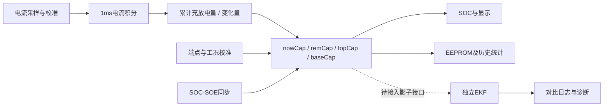

# 现有 SOC、SOE 与保护链

## SOC 的主链

现有SOC由电流采样与积分、容量状态、端点及工况校准、SOC/SOE同步、显示处理共同组成。应把它作为一个状态系统理解，而不是一个可直接替换的百分比变量。

依据：`BSPISRHook.c:90-97`、`OSUserHOOK.c:514-523`、`CapInfoCalc.c:150-171`、`SocUserAPI.c:57-105`。相对路径分别可由检索页按文件名定位。

## 单位和周期

| 对象 | 当前代码约定 | 对接时要做什么 |
|---|---|---|
| GetGRealCurr10mAAPI | 10mA；充电负、放电正 | 乘0.01变为A，并核对分流器通道与零漂 |
| GetGCellAvgVoltAPI | 1mV | 乘0.001变为单体V |
| GetGCellAvgTempAPI | 1℃ | 当前BMS下无需乘0.1 |
| GetGRealSocMilliAPI | 0～1000，对应0～100% | 乘0.001变为0～1 |
| GetGroupTotalCapAPI / StandCap | mAh | 乘0.001变为Ah，再由EKF内部乘3600变为As |
| GetChgDhgChangCapAPI | mAh；放电正、充电负 | 与累加方向保持一致 |

电流、SOC和容量约定的适配调用位于 `EKF/SocEst/ekf_adapter.c:18-23,48-57,80-82`；电压/温度原接口证据为 `BMS/Sources/Funtion/SystemInfo/GroupInfo.c:1987-2008`；变化电量证据为 `CurrIntegral.c:233-241`。累计历史电量接口还受 `SMALL_ESS_EN` 控制，不应把所有Cap接口一律当同一种单位。

1ms中断调用积分，不意味着所有容量状态每1ms更新。`GroupCapSocCalcTask`入口每100ms调用，内部交替处理nowCap与remCap，所以各分支名义上每200ms执行一次，并分别进入EEPROM保存函数。保存函数仍有自身条件，不能据入口频率断言EEPROM每200ms物理写一次。

## SOC/SOE 校准与持久化

`Sources/Funtion/SocLib/SocUserAPI.c`安排总容量/能量标定、SOC/SOE相互同步、组间同步和修正。`CorrGNowCapBySocAPI`不是只修改显示值，而是依据容量上下界回算当前容量（`CapInfoCalc.c:175`起）。

后续替换SOC算法须明确哪些状态由旧算法持有、哪些由EKF估计、什么时候回写容量、何时允许持久化。直接改显示SOC会留下容量、SOE、历史统计和下次重启状态不一致的可能性。当前影子模式更适合先验证单位与模型。

## 诊断、保护、均衡与记录

10ms轮询中建立电压/温度/电流、端口及状态异常诊断；50ms执行故障滤波；100ms执行工作状态、SOS等级与 `GroupProtectTask`。这是检测、滤波、状态与执行分开的链路，不能仅凭某个阈值判断继电器何时动作（`OSUserHOOK.c:495-511,568-608`）。

`Sources/Funtion/Diagnosis/DiagInterface.c:42-55`还存在紧急模式下指定欠压故障保护屏蔽钩子；这是需要结合产品需求核对的行为，不能直接认定设计错误。

`Sources/Logics/Balance/BalanTactic.c:107-210`按状态机处理均衡：调试/禁用/通信异常/采样异常时清理状态；压差积分后生成均衡请求；被动放电分支有调用，主动充电+被动放电分支在188-190行为占位。需区别框架支持与具体实现。

记录路径通过 `RecordInterface.c:610-664`的外部Flash读、写、擦除接口处理；软件300ms回调交替触发600ms记录处理。记录内容的编码、掉电完整性和耐久策略仍需专项核验。

## 已发现的局部逻辑问题

`Sources/Funtion/SocLib/SocSoeSync.c:114-132`在 `nowSoc <= 200`之后出现 `<=25`和`<=30`，在该else-if链上这两分支不可达。注释对应20%～25%与25%～30%，与0.1%单位不一致。这是静态可证的分支问题；建议用边界值200/201/250/251/300/301验证，再核对期望SOE修正规则。本轮仅记录，未修改固件。

其他容量/SOH缩放、ISR共享数据同步、零漂、EEPROM掉电恢复和异常采样下的降级路径，列入后续专项审计，不以本轮建档替代验证。
